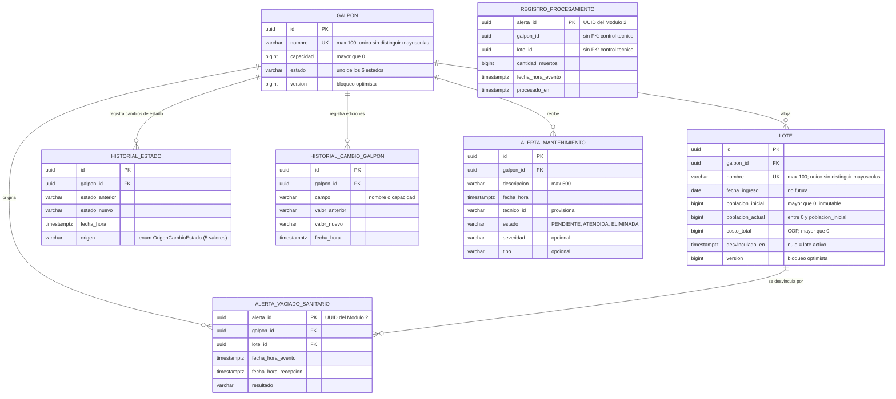

# Implementation Plan: AVICONTROL Modulo 1 - Gestion de Galpones e Infraestructura

**Fecha**: 2026-10-02
**Arquitectura y tecnologías**: [arquitectura.md](../arquitectura/arquitectura.md)

## Summary

El Modulo 1 es la fuente de verdad sobre los galpones y lotes de pollos. Gestiona el ciclo de vida del galpon (maquina de estados de 6 estados y 9 transiciones), mantiene la poblacion actual del lote y expone los datos que el Modulo 2 y el Modulo 3 necesitan.

Implementacion: monolito con arquitectura hexagonal (domain, application, infrastructure) en Java 21 + Spring Boot. El Modulo 2 se integra por Apache Kafka (consumers). El Modulo 3 consulta por API REST. Persistencia en PostgreSQL con Flyway.

## Technical Context

Stack, arquitectura hexagonal, reglas de persistencia, API, tiempo y pruebas: ver [arquitectura.md](../arquitectura/arquitectura.md). Las convenciones de contrato (nulos omitidos, página desde 1, formato de error) y el perfil local también están ahí. Este plan no los repite.

**Alcance específico del Módulo 1**:
- Servicio backend: API REST para consultas síncronas (Módulo 3) y consumers Kafka para eventos del Módulo 2.
- Una sola granja, decenas de galpones, 10 casos de uso, 1 administrador, 1 técnico de infraestructura.
- Rendimiento: p95 menor a 300 ms en consultas y escrituras; paginación de 10 registros.

**Restricciones propias del módulo**:
- Las operaciones multi-paso son atómicas: registrar lote + cambio de estado; vaciado + desvinculación de lote.
- Los eventos del Módulo 2 son idempotentes: el UUID de alerta es la clave en `RegistroProcesamiento`.
- Nombres de galpón y lote únicos sin distinguir mayúsculas y sin espacios extremos.
- Autenticación fuera del alcance de este plan (P-01).

---

## Project Structure

### Documentation

```
docs/
├── arquitectura/arquitectura.md      (referencia técnica compartida)
├── plan-general/
│   └── plan-modulo-1.md              (este archivo: lo compartido + índice)
├── templates/                        (plantillas de spec y de plan)
├── Casos de uso.md
└── spec-<caso-de-uso>/               (10 carpetas)
    ├── <spec>.md
    └── plan-<caso-de-uso>.md         (plan de implementación de ese spec)
```

### Source Code (esqueleto; las clases de cada caso están en su plan)

```
avicontrol/
├── pom.xml
├── docker-compose.yml
└── src/
    ├── main/java/com/unimag/avicontrol/
    │   ├── domain/           model/, port/out/, policy/, exception/
    │   ├── application/      port/in/, usecase/
    │   └── infrastructure/
    │       ├── in/rest/      controladores, dto/, mapper/, GlobalExceptionHandler
    │       ├── in/kafka/     consumers y dto/ (mensajes del Módulo 2)
    │       ├── in/job/       tareas programadas
    │       ├── out/persistence/  entity/, repository/, adapter/, mapper/
    │       └── config/
    └── test/java/com/unimag/avicontrol/
        domain/, application/, infrastructure/, arquitectura/, soporte/
```

**Structure Decision**: arquitectura hexagonal (ver arquitectura.md). Los eventos del Módulo 2 entran por `infrastructure/in/kafka/` y las consultas del Módulo 3 por `infrastructure/in/rest/`. Los records Kafka y los DTOs REST son clases separadas aunque compartan campos de los specs.

## Modelo de datos

Diagrama entidad-relación del esquema que crea `V1__esquema_inicial.sql` (T006). Los nombres de columna, tipos y restricciones son la propuesta de este plan: los specs definen los atributos, no el esquema. El diagrama usa Mermaid (se ve en GitHub, en la vista previa de VS Code con la extensión Mermaid y en IntelliJ).



### Tablas y quién las usa

| Tabla | Spec que la escribe | Notas |
|---|---|---|
| `galpon` | Registrar galpón, Editar galpón, Actualizar estado (solo `estado`) | Único dueño del estado: solo `GalponEstadoService` lo cambia |
| `lote` | Registrar lote, Actualizar población actual, Recibir vaciado sanitario (`desvinculado_en`) | Un lote activo es el de `desvinculado_en IS NULL` (P-08) |
| `historial_estado` | Actualizar estado (vía `GalponEstadoService`) | Una fila por cambio, con su origen |
| `historial_cambio_galpon` | Editar galpón | Una fila por campo realmente cambiado |
| `alerta_mantenimiento` | Generar alerta de mantenimiento | `ELIMINADA` existe pero sin flujo (P-21) |
| `alerta_vaciado_sanitario` | Recibir vaciado sanitario | Conserva `galpon_id` y `lote_id` aunque el lote se desvincule (FR-009) |
| `registro_procesamiento` | Actualizar población actual | Control técnico de idempotencia de mortalidad; sin FK a propósito |

La alerta sanitaria **no se guarda** (FR-004 del spec): no tiene tabla. La alerta de mortalidad tampoco es una entidad de negocio; solo deja su fila de `registro_procesamiento`.

### Restricciones e índices

| Tabla | Restricción o índice | Para qué |
|---|---|---|
| `galpon` | `UNIQUE (lower(nombre))`; `CHECK (capacidad > 0)`; `CHECK` de los seis estados | Nombre único sin distinguir mayúsculas; entero positivo; estado válido |
| `lote` | `FK galpon_id -> galpon` (obligatoria); `UNIQUE (lower(nombre))` | Lote siempre de un galpón; nombre único |
| `lote` | `CHECK (poblacion_inicial > 0 AND costo_total > 0 AND poblacion_actual BETWEEN 0 AND poblacion_inicial)` | Enteros positivos; la población nunca es negativa ni supera la inicial |
| `lote` | `UNIQUE (galpon_id) WHERE desvinculado_en IS NULL` | Un solo lote activo por galpón |
| `lote` | Índice `(galpon_id, fecha_ingreso DESC)` | Historial de lotes del galpón |
| `historial_estado` | Índice `(galpon_id, fecha_hora DESC)` | Historial paginado |
| `alerta_mantenimiento` | `UNIQUE (galpon_id) WHERE estado = 'PENDIENTE'`; `CHECK (char_length(descripcion) <= 500)` | Una sola alerta pendiente por galpón, también en concurrencia |
| `alerta_vaciado_sanitario` | `PK (alerta_id)`; FK a `galpon` y `lote` | Idempotencia por UUID del Módulo 2 |
| `registro_procesamiento` | `PK (alerta_id)` | Un mismo UUID no se aplica dos veces |

Las columnas `version` de `galpon` y `lote` son el bloqueo optimista de las ediciones normales; el cambio de estado usa bloqueo pesimista (`findByIdForUpdate`), según [arquitectura.md](../arquitectura/arquitectura.md#persistencia-y-transacciones).

---
## Phase 1: Setup

**Purpose**: Dejar el proyecto listo para implementar API REST, consumers Kafka y base de datos.

- [ ] T001 Crear estructura de paquetes en main/ y test/ segun el arbol de Project Structure
- [ ] T002 Actualizar pom.xml: agregar spring-boot-starter-webmvc, spring-boot-starter-validation, spring-kafka, Flyway, Testcontainers (solo PostgreSQL), ArchUnit y dependencias MockMvc; quitar spring-boot-starter-restclient. Verificar artefactos Boot 4.1.1 con mvnw dependency:tree
- [ ] T003 [P] Crear docker-compose.yml con PostgreSQL y Kafka para desarrollo local
- [ ] T004 [P] Configurar application.properties y application-test.properties: datasource, Kafka bootstrap servers, ddl-auto=validate, Jackson strict, avicontrol.*
- [ ] T005 [P] Agregar plugin JaCoCo al pom.xml

---

## Phase 2: Foundational (Bloqueante)

**Purpose**: Infraestructura tecnica que todas las historias necesitan.

**CRITICO**: Ninguna historia empieza hasta completar esta fase.

- [ ] T006 Escribir V1__esquema_inicial.sql segun el [Modelo de datos](#modelo-de-datos): 7 tablas, restricciones CHECK, indices unicos lower(nombre), indices parciales (lote activo, alerta pendiente por galpon)
- [ ] T007 [P] Crear enums EstadoGalpon, OrigenCambioEstado, EstadoAlertaMantenimiento y AccionSanitaria en main/domain/model/
- [ ] T008 [P] Crear modelos de dominio Galpon y Lote (Java puro) en main/domain/model/; crear GalponEntity y LoteEntity (con @Version) en main/infrastructure/out/persistence/entity/
- [ ] T009 [P] Crear modelos de dominio HistorialEstado, HistorialCambioGalpon, AlertaMantenimiento, AlertaVaciadoSanitario y RegistroProcesamiento en main/domain/model/; crear sus entidades JPA en main/infrastructure/out/persistence/entity/
- [ ] T010 Crear interfaces de puertos de salida en main/domain/port/out/ (incluida GalponRepository.findByIdForUpdate); crear interfaces JpaRepository en main/infrastructure/out/persistence/repository/; crear adaptadores en main/infrastructure/out/persistence/adapter/ (depende de T008, T009)
- [ ] T011 [P] Crear mappers de persistencia en main/infrastructure/out/persistence/mapper/
- [ ] T012 [P] Crear excepciones de negocio en main/domain/exception/
- [ ] T013 [P] Crear GlobalExceptionHandler en main/infrastructure/in/rest/: traduce excepciones de dominio a ProblemDetail (RFC 9457) con `type`, `title`, `status`, `detail`, `instance`, `code` y `fieldErrors` según [Formato de error](../arquitectura/arquitectura.md#formato-de-error); `VALIDACION_FALLIDA` cuando fallan varios campos
- [ ] T014 [P] Crear ClockConfig (zona America/Bogota), JacksonConfig (ACCEPT_FLOAT_AS_INT=false y `spring.jackson.default-property-inclusion=non_null`, para no enviar nulos), KafkaConsumerConfig (grupo modulo-1, deserializador JSON que ignora campos desconocidos) y AvicontrolProperties en main/infrastructure/config/
- [ ] T015 Crear TransicionesPermitidas en main/domain/policy/ con la matriz de 9 transiciones
- [ ] T016 Crear GalponEstadoService en main/application/usecase/: metodo solicitarCambio invoca GalponRepository.findByIdForUpdate, valida en TransicionesPermitidas, persiste cambio y escribe historial (depende de T010, T015)
- [ ] T017 [P] Pruebas unitarias de TransicionesPermitidas y GalponEstadoService en test/application/: 9 transiciones validas, invalidas y estado ya cambiado
- [ ] T018 [P] Crear clase base Testcontainers en test/soporte/ con PostgreSQL y Clock fijo (solo para pruebas de persistencia)
- [ ] T019 [P] Escribir reglas ArchUnit en test/arquitectura/: direccion de dependencias, JPA ausente en domain y application, @Transactional solo en application/usecase, solo GalponEstadoService escribe estado
- [ ] T085 [P] Crear `NombreNormalizado` en main/domain/model/: recorta espacios, exige 1 a 100 caracteres con solo letras, números, espacios, guiones y guiones bajos, y expone la clave de unicidad en minúsculas; lo usan registrar galpón, registrar lote y editar galpón. Pruebas unitarias en test/domain/ — clase `NombreNormalizadoTest` (nombre vacío, solo espacios, 101 caracteres, caracteres no permitidos, "Galpón A" y " galpón a " con la misma clave)
- [ ] T086 [P] Crear `FixtureJson` en test/soporte/: carga los JSON de `src/test/resources/contratos/` y los compara con la respuesta de MockMvc o los deserializa en las pruebas de los consumers; lo usan todas las pruebas de contrato
- [ ] T087 [P] Crear `EventoEnvelope<T>` (record genérico del sobre de eventos del Módulo 2: `eventId`, `eventType`, `eventVersion`, `occurredAt`, `publishedAt`, `producer`, `correlationId`, `causationId`, `aggregateType`, `aggregateId`, `payload`) en main/infrastructure/in/kafka/dto/, con un `ObjectMapper` que ignora campos desconocidos. Pruebas unitarias — clase `EventoEnvelopeTest` (campos extra ignorados, `eventVersion` distinta de 1 rechazada) (P-06)

**Checkpoint**: esquema migra, entidades validan, maquina de estados funciona, ArchUnit pasa.

T085 a T087 se agregaron después de T084; la numeración de las tareas no se reutiliza ni se reordena.

---

## Planes por spec (Phases 3 a 11)

Cada caso de uso tiene su propio plan de implementación junto a su spec. Las tareas conservan su numeración T021-T079; las pruebas unitarias agregadas después son T091-T099. Cada plan incluye además el código completo de su caso de uso (servicio, controller o consumer, DTOs, puertos y adaptadores propios) y, por cada petición o mensaje del spec, todos sus escenarios con path params, query params, body y respuesta.

| Historia | Spec | Plan | Tareas |
|---|---|---|---|
| US1 (P1) | Registrar galpón | [plan-registrar-galpon](../spec-registrarGalpon/plan-registrar-galpon.md) | T021-T028 |
| US2 (P1) | Registrar lote | [plan-registrar-lote](../spec-registrarLote/plan-registrar-lote.md) | T029-T036 |
| US3 (P1) | Consultar galpón y lote | [plan-consultar-galpon-lote](../spec-consultar-galpón-lote/plan-consultar-galpon-lote.md) | T037-T042, T091-T092 |
| US4 (P1) | Actualizar estado | [plan-actualizar-estado](../spec-actualizarEstado/plan-actualizar-estado.md) | T043-T047, T093 |
| US5 (P1) | Actualizar población actual | [plan-actualizar-poblacion-actual](../spec-actualizarPoblaciónActual/plan-actualizar-poblacion-actual.md) | T050-T052, T055 (parte), T099 |
| US5 (P1) | Recibir mortalidad del galpón | [plan-recibir-mortalidad](../spec-recibirMortalidadDelGalpón/plan-recibir-mortalidad.md) | T048, T050-T051, T053-T055 (parte) |
| US6 (P1) | Recibir alerta sanitaria | [plan-recibir-alerta-sanitaria](../spec-recibirAlertaSanitaria/plan-recibir-alerta-sanitaria.md) | T056-T061, T094 |
| US7 (P1) | Recibir vaciado sanitario | [plan-recibir-vaciado-sanitario](../spec-recibirVaciadoSanitario/plan-recibir-vaciado-sanitario.md) | T062-T068, T095-T096 |
| US8 (P1) | Generar alerta de mantenimiento | [plan-generar-alerta-mantenimiento](../spec-generarAlertaMantenimiento/plan-generar-alerta-mantenimiento.md) | T069-T074, T097 |
| US9 (P3) | Editar galpón | [plan-editar-galpon](../spec-editarGalpon/plan-editar-galpon.md) | T075-T079, T098 |

---

## Catálogo de servicios

### Servicios REST (`/api/v1`)

Todos siguen las [convenciones de contrato](../arquitectura/arquitectura.md#convenciones-de-contrato): `page` desde 1, campos ausentes omitidos (nunca `null`), errores RFC 9457 con `type`, `title`, `code` y `fieldErrors`. Las rutas y los campos son propuestos (P-09).

| Método | Ruta | Spec | Request DTO | Response DTO |
|---|---|---|---|---|
| POST | `/api/v1/galpones` | Registrar galpón | `RegistrarGalponRequest` | `GalponResponse` |
| GET | `/api/v1/galpones` | Consultar galpón y lote | — | `GalponPaginaResponse` |
| GET | `/api/v1/galpones/{galponId}` | Consultar galpón y lote | — | `GalponDetalleResponse` |
| GET | `/api/v1/galpones/{galponId}/lotes` | Consultar galpón y lote | — | `LoteHistorialResponse` |
| PATCH | `/api/v1/galpones/{galponId}` | Editar galpón | `EditarGalponRequest` | `GalponResponse` |
| GET | `/api/v1/galpones/{galponId}/transiciones` | Actualizar estado | — | `TransicionesDisponiblesResponse` |
| PATCH | `/api/v1/galpones/{galponId}/estado` | Actualizar estado | `ActualizarEstadoRequest` | `CambioEstadoResponse` |
| GET | `/api/v1/galpones/{galponId}/historial-estados` | Actualizar estado | — | `HistorialEstadoPaginaResponse` |
| POST | `/api/v1/lotes` | Registrar lote | `RegistrarLoteRequest` | `LoteResponse` |
| GET | `/api/v1/lotes` | Registrar lote | — | `LotePaginaResponse` |
| POST | `/api/v1/alertas-mantenimiento` | Generar alerta de mantenimiento | `GenerarAlertaMantenimientoRequest` | `AlertaMantenimientoResponse` |
| GET | `/api/v1/alertas-mantenimiento` | Generar alerta de mantenimiento | — | `AlertaMantenimientoPaginaResponse` |
| PATCH | `/api/v1/alertas-mantenimiento/{alertaId}` | Generar alerta de mantenimiento | `AtenderAlertaRequest` | `AtenderAlertaResponse` |

### Mensajes Kafka (Módulo 2 -> Módulo 1)

| Tópico | Spec | Mensaje (`payload` del sobre) | Consumer |
|---|---|---|---|
| `avicontrol.mortalidad` | Recibir mortalidad del galpón | `MortalidadMessage` | `MortalidadConsumer` |
| `avicontrol.alerta-sanitaria` | Recibir alerta sanitaria | `AlertaSanitariaMessage` | `AlertaSanitariaConsumer` |
| `avicontrol.vaciado-sanitario` | Recibir vaciado sanitario | `VaciadoSanitarioMessage` | `VaciadoSanitarioConsumer` |

Los mensajes llegan dentro del [sobre de eventos](../arquitectura/arquitectura.md#sobre-de-eventos) del Módulo 2 (P-06). Los cuatro specs que se comunican con otros módulos (consultar galpón y lote, recibir mortalidad, recibir alerta sanitaria y recibir vaciado sanitario) tienen en su plan una sección *Coherencia entre módulos*.

---

## Phase 12: Polish y preocupaciones transversales

**Purpose**: Mejoras que afectan multiples historias.

- [ ] T080 [P] Verificar que cada escenario de aceptacion de los 10 specs tenga su prueba; completar las faltantes
- [ ] T081 [P] Alcanzar 80% de cobertura de lineas en application/usecase segun JaCoCo
- [ ] T082 [P] Documentar en README.md: levantar PostgreSQL + Kafka con Docker Compose, ejecutar pruebas, perfil `local` con el simulador del Modulo 2, endpoints REST y topicos Kafka para el Modulo 2
- [ ] T083 [P] Agregar logs de cambios de estado y alertas rechazadas en consumers Kafka
- [ ] T084 Revisar manejo de errores cuando base de datos o Kafka no estan disponibles: mensaje generico y sin cambios parciales
- [ ] T088 [P] Crear `SimuladorModulo2` en main/infrastructure/local/ (solo con el perfil `local`): expone `POST /local/simulador-modulo2/{mortalidad|alerta-sanitaria|vaciado-sanitario}` que recibe un `payload`, lo envuelve en el sobre del Módulo 2 y lo publica en el tópico correspondiente; sirve para la demostración sin el Módulo 2 y reutiliza los JSON de `src/test/resources/contratos/`. No es una prueba de integración y no se ejecuta con `mvnw test`
- [ ] T089 [P] Crear `db/local/V1000__datos_locales.sql` (galpones en cada estado y un lote activo) y `application-local.properties`, que activa esa carpeta en Flyway solo con el perfil `local`
- [ ] T090 Enviar a los equipos de los Módulos 2 y 3 los contratos de este plan (catálogo de servicios y fixtures de consultar, mortalidad, alerta sanitaria y vaciado) como propuesta concreta de P-06 y P-09, y llevar P-10 y P-11 a la reunión con los otros grupos

---

## Dependencies & Execution Order

### Phase Dependencies

- **Setup (Phase 1)**: sin dependencias — empieza de inmediato
- **Foundational (Phase 2)**: depende de Setup — bloquea todas las historias
- **User Stories (Phases 3 a 11)**: dependen de Foundational — pueden repartirse en paralelo con varios integrantes
- **Polish (Phase 12)**: depende de las historias entregadas

### User Story Dependencies

- **US1 Registrar galpon**: sin dependencias entre historias
- **US2 Registrar lote**: sin dependencias; galpones se crean en la prueba
- **US3 Consultar**: sin dependencias; sirve para verificar resultados de otras historias
- **US4 Actualizar estado**: solo de Foundational (GalponEstadoService ya listo)
- **US5 Mortalidad**: necesita lote activo creado con datos de prueba
- **US6 Alerta sanitaria**: necesita lote activo creado con datos de prueba
- **US7 Vaciado sanitario**: necesita galpon En cosecha creado con datos de prueba
- **US8 Alerta de mantenimiento**: solo de Foundational
- **US9 Editar galpon**: sin dependencias entre historias

Con varios integrantes, despues de Phase 2 las historias pueden repartirse. Con una persona, seguir el orden de las fases.

### Within Each User Story

- Modelos de dominio y entidades JPA antes que puertos y adaptadores
- Puerto de entrada antes que el caso de uso
- Caso de uso antes que el adaptador de entrada (REST o Kafka)
- Historia completa y probada antes de pasar a la siguiente
- Pruebas de contrato y de consumer se pueden escribir primero (TDD)

---

## Pendientes de clarificación

Las preguntas abiertas llevan un ID (`P-nn`) que los planes por spec citan en su sección *Pendientes de clarificación*. Las que bloquean la coherencia con los otros módulos son:

| ID | Tema | Con quién |
|---|---|---|
| P-06 | Formato del mensaje Kafka y sobre de eventos | Módulo 2 |
| P-09 | Rutas y nombres de campo propuestos (`capacidad` frente a `aforoMaximo`, `/api/v1`) | Módulos 2 y 3 |
| P-10 | Topología: procesos separados (Kafka y REST) o mismo proceso | Módulo 2 y profesor |
| P-11 | Dueño de la población actual | Módulo 2 |
| P-08 | Criterio de lote activo | Módulo 2 y profesor |

## Notes

- Por indicacion del profesor no se escriben pruebas de integracion ni end-to-end en el proyecto. Se eliminaron T020, T030, T049, T057 y T063 (su numeracion no se reutiliza) y sus casos se trasladaron a pruebas unitarias (T017, T036, T055, T056, T062).
- Las pruebas de persistencia con Testcontainers PostgreSQL (T022, T038, T070) se mantienen porque verifican indices y consultas propias de PostgreSQL; confirmar con el profesor que no cuentan como integracion (P-19).
- Los JSON de ejemplo de cada plan son *fixtures* en `src/test/resources/contratos/` y la evidencia de contrato entre modulos. El simulador del Modulo 2 (T088) es solo una herramienta de demostracion.

- [P] = puede hacerse en paralelo con otras tareas [P] del mismo bloque
- [USn] enlaza la tarea con su historia para trazabilidad
- Cada historia debe poder completarse y probarse de forma independiente
- Commit despues de cada tarea o grupo logico
- Detenerse en cada checkpoint para validar la historia antes de continuar
